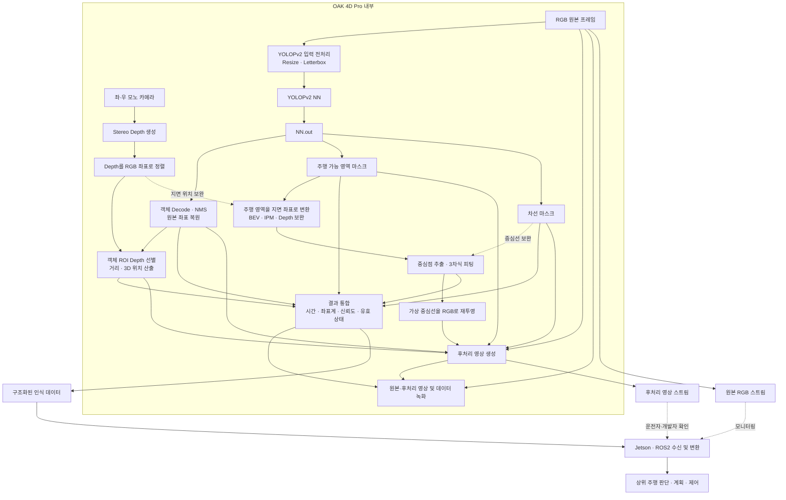

# CAM01 OAK 4D Pro 전방 인식 개발 방향

작성일: 2026-10-15  
작성 주체: 큐센텍  
문서 상태: 요구사항 및 개발 방향 정리, 구현 전

## 1. 목적

CAM01 중앙 전방 카메라에 OAK 4D Pro를 적용하고, YOLOPv2 인식 결과와
Stereo Depth를 결합하여 상위 주행 판단 시스템에 필요한 전방 환경 정보를
생성하는 프로그램의 개발 방향을 기록한다.

이 문서는 2026-10-15 협의 내용을 정리한 설계 기준이다. 현재 저장소에 아래
기능이 모두 구현되었다는 의미는 아니다. 코드 작성은 별도 요청 이후 진행한다.

## 2. 확인된 개발 목표

- 중앙 전방 영상은 CAM01 OAK 4D Pro를 사용한다.
- 기본 인식 모델은 YOLOPv2를 사용한다.
- YOLOPv2의 기본 후처리 결과는 주행 가능 영역 마스크, 차선 마스크, 객체
  클래스·신뢰도·바운딩 박스로 정의한다.
- OAK 4D Pro 내부 Linux에서 `NN.out` 이후 후처리를 수행하는 구성을 우선
  검토한다.
- RGB에 정렬된 Stereo Depth와 객체 박스를 결합하여 객체 거리와 카메라 기준
  3차원 위치를 계산한다.
- 주행 가능 영역에서 차량이 추종할 가상 중심선을 구하고 3차 다항식으로
  표현한다.
- 원본 RGB 영상과 모든 결과가 표시된 후처리 영상을 각각 제공하고 녹화한다.
- 상위 주행 판단 시스템용 구조화 데이터도 별도로 생성한다.
- 전체 기능 동시 실행 상태에서 10 FPS, 지연, 정확도 및 연속 동작 안정성을
  실측하여 최종 실행 위치를 결정한다.

## 3. 관련 프로그램 확인 상태

임시 로컬 프로젝트 `D:\git_hub\OAK_4D_PRO`에서 검증한 기준 코드를 정식
저장소로 선별 이관했다. 이후 개발의 정본은 이 저장소의 다음 경로이다.

| 항목 | 경로 | 확인 상태 |
| --- | --- | --- |
| 영상 녹화 프로그램 | `tools/oak_recorder.py` | 기준 코드 이관 완료 |
| YOLOPv2 Standalone 앱 | `apps/yolopv2_standalone/main.py` | 기준 코드 이관 완료 |
| YOLOPv2 후처리 | `apps/yolopv2_standalone/postprocess.py` | 기준 코드 이관 완료 |
| OAK App 설정 | `apps/yolopv2_standalone/oakapp.toml` | 기준 코드 이관 완료 |

현재 영상 녹화 프로그램은 오버레이되지 않은 RGB 영상과 후처리 영상을 출력한다.
정식 저장소 이관본은 원본 코드와 해시를 대조하고 정적 검사를 수행하되, 실제
장비 동작은 단계별 장비 검증으로 다시 확인한다. 대용량 NNArchive는 Git 추적에서
제외하고 로컬 배포 파일로 관리한다.

## 4. 목표 처리 구조



## 5. 객체와 Depth 결합

처리 순서는 다음과 같다.

1. RGB, Depth 및 NN 결과를 timestamp 또는 frame sequence로 동기화한다.
2. Depth를 RGB 카메라 좌표에 정렬한다.
3. Letterbox, resize 또는 crop 정보를 이용해 객체 박스를 원본 RGB 좌표로
   복원한다.
4. 객체 박스의 내부 영역에서 유효한 Depth를 추출한다.
5. 배경 혼입과 이상치를 제거하고 중앙값 또는 합의된 분위수로 대표 거리를
   계산한다.
6. 카메라 보정값을 이용해 필요한 경우 카메라 좌표계의 `X`, `Y`, `Z`를
   계산한다.
7. 유효 Depth 비율이 기준보다 낮으면 거리값과 함께 거리 무효 상태를 전달한다.

객체 결과 후보는 클래스, 신뢰도, 원본 RGB 기준 바운딩 박스, 대표 거리,
카메라 기준 3차원 위치, 거리 유효 여부, 유효 Depth 비율, timestamp와 frame
ID이다. 박스 중심의 Depth 한 점만 사용하는 방식은 측정 실패와 배경 혼입에
취약하므로 기본 방식으로 사용하지 않는다.

## 6. 가상 중심선 생성

가상 중심선은 주행 가능 영역 마스크에서 구한다. 차선 마스크와 Depth는 중심선
품질을 보완하고 검증하는 입력으로 사용한다.

```text
주행 가능 영역 마스크
  → 노이즈 제거 및 유효 연결 영역 선택
  → 차량 지면 좌표계 또는 BEV로 변환
  → 좌우 경계 또는 영역 skeleton 추출
  → 전방 거리별 중심점 생성
  → 3차 다항식 피팅
  → 유효 거리와 신뢰도 평가
  → RGB 영상으로 재투영
```

중심선 모델은 다음 식을 기준으로 한다.

```text
y_C(x) = c0 + c1*x + c2*x^2 + c3*x^3
```

- `x`: 차량 전방 거리(m)
- `y`: 차량 중심 기준 좌우 위치(m)
- `c0`: 현재 위치 기준 횡방향 오프셋
- `c1`: 진행 방향 기울기
- `c2`, `c3`: 곡률과 곡률 변화 표현

좌우 경계를 모두 얻은 경우 `y_C(x) = (y_L(x) + y_R(x)) / 2`로 계산한다.
한쪽 경계만 유효하면 검증된 도로 폭 모델을 사용한다. 영상 픽셀 좌표에서 직접
3차식을 피팅하지 않고 차량 지면 좌표계에서 피팅한 뒤 RGB 영상으로 재투영한다.

일반적인 곡률은 아래 식으로 계산하며, `2*c2`는 `c1`이 충분히 작은 위치에서의
근사로만 취급한다.

```text
kappa(x) = (2*c2 + 6*c3*x)
           / (1 + (c1 + 2*c2*x + 3*c3*x^2)^2)^(3/2)
```

주행 가능 영역의 기하학적 중심과 장애물을 고려한 최종 주행 경로는 구분한다.
객체 회피와 실제 조향 경로 생성은 상위 판단·계획 단계의 책임으로 둔다.

## 7. 후처리 영상과 데이터 출력

후처리 영상에는 다음 정보를 표시한다.

- 반투명 주행 가능 영역 마스크
- 차선 마스크
- 객체 박스, 클래스 및 신뢰도
- 객체 거리와 거리 무효 상태
- 3차식 기반 가상 중심선
- 중심선 유효 거리 및 필요 시 `c0`~`c3`
- 중심선 계산 실패 시 명확한 무효 표시

프로그램 출력은 다음과 같이 구분한다.

| 출력 | 목적 | 주요 내용 |
| --- | --- | --- |
| 원본 RGB 영상 | 원본 확인 및 재현 | 오버레이되지 않은 RGB |
| 후처리 영상 | 운전자·개발자 확인 | 마스크, 박스, 거리, 가상 중심선 |
| 구조화 데이터 | 상위 프로그램 입력 | 객체, 거리, 마스크, 중심선, 상태 정보 |
| 녹화 파일 | 재생·평가·회귀 검증 | 원본/후처리 영상과 동기화된 결과 데이터 |

후처리 영상은 확인용이다. 상위 주행 판단 시스템은 영상에서 결과를 다시
추출하지 않고 구조화 데이터를 직접 사용한다.

## 8. 현재 상태

| 항목 | 상태 | 비고 |
| --- | --- | --- |
| 개발 목적 및 기본 출력 정의 | 정리 완료 | 본 문서 기준 |
| OAK 4D Pro 기준 코드 이관 | 완료 | `apps/yolopv2_standalone`, `tools/oak_recorder.py` |
| 현재 녹화 프로그램 세부 코드 분석 | 완료 | 기존 RGB/결과 RTSP와 MP4 녹화 경로 확인 |
| YOLOPv2 OAK4 실제 출력 검증 | 검증 필요 | tensor 이름·shape·좌표 확인 필요 |
| RGB-Depth 정렬 | 구현 완료/장비 검증 필요 | RVC4 `StereoDepth -> ImageAlign`, `DepthAligned` |
| Windows 멀티뷰 UI | 기본 구조 구현 완료 | RGB/결과 표시, Depth/BEV 연동 대기 표시 |
| 객체 거리 및 3D 위치 | 미구현 | 거리 유효성 기준 필요 |
| 가상 중심선 3차식 | 미구현 | BEV와 fitting 범위 결정 필요 |
| 후처리 영상 중심선 표시 | 미구현 | 재투영 및 시각화 필요 |
| ROS2 인터페이스 | 미확정 | 수신 측과 메시지 규격 협의 필요 |
| 통합 10 FPS | 미검증 | 전체 기능 동시 실행 실측 필요 |

## 9. 구현 전 확정 및 검증 항목

- YOLOPv2 모델 파일, 입력 크기, 출력 tensor 이름과 shape
- 현재 녹화 프로그램의 RGB/후처리 frame 동기화 방식
- OAK4 Luxonis OS 1.41.0과 앱 DepthAI 3.8.0 조합의 장비 실행 확인
- `ROBOTICS`, LR-check, subpixel 설정의 거리별 품질·성능 실측
- 카메라 intrinsic/extrinsic 및 차량 기준 설치 자세
- 객체별 대표 거리 정책과 유효성 임계값
- 중심선 BEV 범위, 샘플 간격, fitting 구간 및 신뢰도 기준
- 구조화 데이터 전송 형식과 ROS2 메시지 변환 위치
- 원본/후처리 영상, Depth 및 결과 데이터의 녹화 범위
- 통합 FPS, 지연, 거리 오차와 중심선 품질의 합격 기준

## 10. 다음 작업 원칙

- 사용자에게 코드 작성 요청을 받기 전까지 구현 코드를 변경하지 않는다.
- `D:\git_hub\OAK_4D_PRO`는 임시 검증 원본으로만 보존하고, 이후 변경은 이
  저장소의 이관본을 기준으로 수행한다.
- 기존 원본 RGB 및 후처리 영상 출력 경로를 유지하면서 Depth 결합과 가상
  중심선 기능을 단계적으로 추가한다.
- 설계값, 코드 확인 결과, 장비 실측 결과를 구분하여 기록한다.

